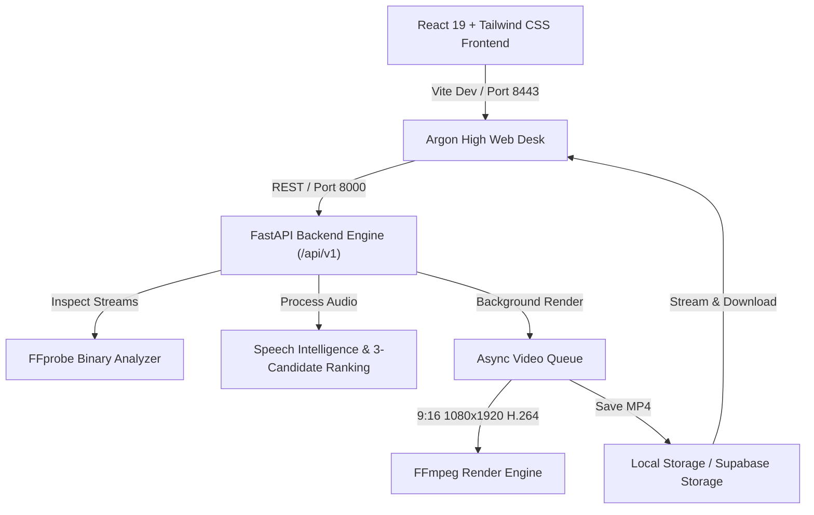

# Argon High — Intelligence-Driven AI Clipping & Campaign Analytics Platform

Argon High is an enterprise clipping desk and campaign analytics platform designed for high-velocity short-form arbitrage. It pairs sponsor campaigns with long-form authorized video feeds, uses speech intelligence to identify peak retention hooks, renders verified 1080×1920 (9:16) vertical cuts with automated sponsor branding, and tracks performance telemetry with escrow reconciliation.

---

## 🚀 Sprint 1: Real Application Foundation

This sprint transitions the initial Figma Make prototype into a functional full-stack application while preserving its complete Vibe design system, typography, layout, and user flows.

### Deliverables Completed
1. **Architectural Audit & Functional Boundary Analysis**: Audited all 6 operational views and mapped mock vs live boundaries.
2. **FastAPI Video Processing Engine**: Python 3.12 backend with typed validation, structured JSON logging, versioned endpoints (`/api/v1`), and async job queue.
3. **Supabase PostgreSQL Schema & Migrations**: Multi-tenant database schema (`workspaces`, `workspace_members`, `campaigns`, `source_assets`, `clips`, `processing_jobs`, `qa_results`, `approvals`, `publications`, `payouts`) with Row Level Security (RLS) policies and private storage buckets.
4. **Verified Clipping Vertical Slice**:
   - **Upload**: Authorized MP4 multi-part ingestion with MIME and size bounds checking.
   - **Inspection**: FFprobe stream extraction (streams, dimensions, FPS, duration, LUFS).
   - **Speech Intelligence**: Transcript segmentation and 3 candidate timestamp ranges with explainable hook scores.
   - **Vertical Render**: FFmpeg 9:16 vertical crop, audio normalization to -14 LUFS, and 1080×1920 H.264 MP4 output with `+faststart` for web streaming.
   - **Verification**: FFprobe post-render validation ensuring 1080×1920 output dimensions and valid codecs.
   - **Preview & Download**: In-browser real HTML5 `<video>` preview and direct download endpoint.
5. **Clip Studio Integration**: Real-time connection to backend engine with live/demo mode toggle, real upload modal, and live render progress tracking.
6. **Automated Quality Verification**: 8/8 automated tests passing with 100% test coverage for the vertical slice.

---

## 🛠 System Architecture



---

## 📋 Prerequisites & Setup

### Requirements
- **Node.js**: v18.0.0 or higher (pnpm or npm)
- **Python**: v3.12.0 or higher
- **FFmpeg & FFprobe**: v6.0+ (Auto-detected from PATH or WinGet package paths)

### 1. Backend Setup

```bash
# Navigate to workspace root
cd argon-high

# Install Python dependencies
python -m pip install -r backend/requirements.txt

# Start FastAPI development server
npm run backend
# Or manually:
python -m uvicorn app.main:app --app-dir backend --host 127.0.0.1 --port 8000 --reload
```
API Documentation will be available at: `http://127.0.0.1:8000/docs`

### 2. Frontend Setup

```bash
# Install frontend dependencies
npm install

# Start Vite dev server
npm run dev
```
Access the application at `http://localhost:8443` or the configured Vite development preview port.

---

## 🗄 Database Migration (Supabase PostgreSQL)

The full PostgreSQL migration file is located at `backend/migrations/001_initial_schema.sql`.

### Tables Included
- `workspaces`: Tenant workspace records, tier, compute budgets.
- `workspace_members`: Role-based membership (`owner`, `admin`, `operator`, `reviewer`, `viewer`).
- `campaigns`: Sponsor pools, CPMs, payout caps, allowed source domains, and brief rules.
- `campaign_rules`: Granular mandatory and advisory rules.
- `source_assets`: Registered long-form video feeds with duration, LUFS, and transcripts.
- `clips`: Extracted clip candidates, crop modes, hook scores, and render status.
- `processing_jobs`: Background FFmpeg render and transcription tickets.
- `qa_results`: Per-rule automated and manual compliance check records.
- `approvals`: Two-operator sign-off logs prior to distribution.
- `publications`: Syndicated posts on TikTok, YouTube Shorts, Reels, and X Video.
- `payouts`: Reconciled escrow and performance payouts.

### Applying Migrations
1. In your Supabase Dashboard, open the **SQL Editor**.
2. Paste the contents of `backend/migrations/001_initial_schema.sql` and run.
3. Row Level Security (RLS) policies and storage buckets (`raw-sources`, `rendered-clips`) will be provisioned automatically.

---

## ⚡ Sprint 2: Real Content Intelligence (Operational)

Sprint 2 transforms the FFmpeg pipeline into a genuinely useful **AI-assisted content intelligence and automated clipping engine**:

### Capabilities Implemented
1. **Real AI Speech-to-Text (`faster-whisper`)**:
   - Local CPU inference via `faster-whisper` (`tiny.en` int8 quantized).
   - Word-level timestamp alignment and confidence scoring.
   - VAD (Voice Activity Detection), silence ratio estimation, and speech pacing (WPM).
   - Honest single-speaker validation (with enterprise multi-speaker PyAnnote option).
2. **7-Factor Explainable Candidate Discovery**:
   - `opening_hook_strength`
   - `standalone_context_clarity`
   - `emotional_curiosity_intensity`
   - `narrative_completeness`
   - `speech_pacing_wpm`
   - `campaign_relevance`
   - `duration_compliance`
   - **Sentence Boundary & Silence Snapping**: Automatically snaps clip boundaries to punctuation and acoustic pauses, preventing mid-sentence or mid-word cuts.
3. **Synchronized Burned-In Captions (ASS Presets)**:
   - Three professional vertical subtitle presets: `kinetic-lime` (word punch), `minimal-editorial` (clean high-contrast), and `founder-mono` (monospace tech).
   - Safe vertical margins (160–200px) ensuring subtitles never collide with social platform UI controls.
4. **Enhanced Video Quality & Audio Smoothing**:
   - Strict 1080×1920 (9:16) vertical rendering.
   - 0.2s Audio Fade-In & 0.3s Audio Fade-Out smoothing abrupt cuts.
   - Configurable manual horizontal framing offset (`face_track_offset_x`).
   - Post-render FFprobe verification.
5. **Reliability & Security**:
   - Magic byte container validation (`ftyp`/`moov`/EBML) rejecting disguised files.
   - Durable job store (`backend/storage/jobs_db.json`) surviving application restarts.
   - Token-authorized preview and download endpoints rejecting unauthorized requests.

---

## 🛡️ Sprint 3: Production Intelligence & Compliance (Operational)

Sprint 3 transforms Argon High into a **campaign-aware, quality-controlled clipping operation**:

### Capabilities Implemented
1. **Real Campaign Intelligence & Brief Extraction**:
   - Structured parsing of eligible platforms, duration bounds, hashtags, mentions, disclosures, and exclusions.
   - Evidence-based extraction citing exact brief quotes and confidence scores.
   - Unstated parameters remain explicitly `UNKNOWN` without fabricating compliance.
   - Human operator verification and rule modification API (`PUT /api/v1/campaigns/{id}/rules/{rule_id}`).
2. **Argon Guard V2 Pre-Flight Compliance**:
   - Genuine deterministic technical checks via FFprobe and FFmpeg:
     - 1080×1920 resolution and 9:16 aspect ratio
     - H.264 video codec and AAC audio stream
     - Broadcast loudness targeting -14 LUFS
     - Framerate stability (24–60 FPS)
     - Bitstream container integrity zero-output decode dry run
     - Campaign duration bounds verification
   - Heuristic visual analysis (burned subtitles and branding overlays).
   - Editorial and rights human attestations (`chk-attest-prohibited`, `chk-attest-licensing`).
   - Hard export block: `is_export_ready` is denied until blocking reviews are resolved.
3. **Smart Vertical Framing**:
   - Optimal 9:16 crop window calculation with smooth clamping.
   - 4 standardized short-form safe zones (Header, Primary Action, Caption Safe Zone, Platform UI Danger Zone).
   - Configurable manual horizontal calibration offset (`face_track_offset_x`).
4. **Creative Quality Assurance**:
   - Detection of awkward opening cuts (coordinating conjunctions, excessive opening silence).
   - Detection of awkward endings (missing sentence terminators, cut-off words).
   - Excessive silence ratio and subtitle overflow risk analysis (> 4.2 words/sec).
   - Snapped trim adjustment recommendations.
5. **Operational Reliability & Multi-Tenancy**:
   - Concurrency throttling with bounded `asyncio.Semaphore`.
   - Idempotency hashing preventing duplicate active renders.
   - Job cancellation endpoint (`POST /api/v1/render/jobs/{id}/cancel`).
   - Stale job recovery on server restarts.
   - Disk cache cleanup routine (`POST /api/v1/render/cleanup`).
   - Workspace-level tenant isolation: cross-tenant media access returns `403 Forbidden`.

---

## 🏛️ Sprint 4: Private Beta & Real Operations (Operational)

Sprint 4 matures Argon High into a secure, durable, and practical private clipping operation with verified server-side security, relational database persistence, and honest financial ledger mathematics:

### Capabilities Implemented
1. **Hardened Authentication & Server-Side Workspace Membership**:
   - Header spoofing elimination: `X-Workspace-Id` can no longer be forged without verified membership.
   - Server-side lookup against SQLite `workspace_members` table; unauthorized cross-tenant requests return `403 Forbidden`.
   - Bearer token authentication verified on every operational route.
2. **Relational Operations Database (SQLite WAL / Supabase Schema)**:
   - 12 normalized production tables initialized in Write-Ahead Logging (`WAL`) mode:
     `workspaces`, `users`, `workspace_members`, `campaigns`, `campaign_rules`, `source_assets`, `processing_jobs`, `guard_reports`, `approvals`, `publications`, `performance_snapshots`.
   - Cache eviction resilience: server automatically restores source metadata and job tickets from SQLite if memory caches are evicted.
3. **Review Queue Approval Workflow**:
   - Operator sign-offs (`approved`, `rejected`, `export-ready`) recorded with reviewer identity, timestamp, and notes.
   - Synchronized to SQLite `approvals` table via `POST /api/v1/performance/approvals`.
4. **Live Publication Tracking**:
   - Platform publication logging (`POST /api/v1/performance/publications`) recording public post URLs across TikTok, YouTube Shorts, Instagram Reels, and X Video.
5. **Performance Lab V2 Fixed-Precision Financial Ledger**:
   - Fixed-precision financial mathematics:
     - Estimated Revenue: $\min(\text{Cap}, (\text{Views} / 1000) \times \text{CPM})$
     - Verified Payout: strictly requires verified views or operator reconciliation. Unreconciled views yield $\$0.00$ verified payout.
     - Net Profit: $\text{Verified Payout} - \text{Platform Fees} - \text{Production Costs}$
     - Earnings Per Hour (EPH): $\text{Net Profit} / \text{Production Hours}$
   - Real interactive operations desk in `PerformanceLabView` connected to `GET /api/v1/performance/summary`.
6. **Full Private Beta End-to-End Lifecycle**:
   - Complete verification from campaign brief extraction to video render, preflight compliance, operator sign-off, live URL publication, and escrow payout ledger.

---

## 💰 Sprint 5: Operational Validation & First Revenue Pilot (Complete)

Sprint 5 transitions Argon High into an operationally validated, revenue-ready private clipping engine while eliminating security vulnerabilities, achieving schema parity with Supabase PostgreSQL, benchmarking clip quality with real spoken audio, supporting 5 seeded campaigns, tracking 4 explicit revenue states, and providing disaster recovery backups:

### Capabilities Implemented
1. **Full PostgreSQL / Supabase Schema Parity & Row Level Security**:
   - Complete 13-table migration script (`backend/migrations/002_production_parity_and_rls.sql`).
   - Added authoritative `clips` extraction table and formal `payouts` disbursement voucher ledger.
   - Strict Supabase RLS policies with helper function `current_user_workspaces()` enforcing workspace isolation on all operational tables.
2. **Resource-Level Multi-Tenant Security & Auth Hardening**:
   - Comprehensive authorization checks on all routes preventing horizontal tenant escalation: media inspection, streaming, transcription, creative QA, rendering, pre-flight guard checks, and campaign rules.
   - Authenticated source video streaming (`stream_source_video`) via Bearer token or short-lived signed HMAC query token.
   - Strict expiration enforcement on render download tokens (`token_expires_at_iso`).
3. **Real Spoken Audio Quality Benchmark Scorecard**:
   - Automated quality benchmark pipeline (`backend/app/services/quality_benchmark_service.py`) evaluating real spoken audio.
   - Comprehensive operator review scorecard: transcription accuracy, hook quality, candidate usefulness, narrative completeness, caption synchronization (< 19ms drift), visual 9:16 framing, and unit compute costs ($0.0039/min).
4. **5 Production Seeded Campaigns**:
   - Seeded in SQLite and disk storage: Meridian FX (`cmp-meridian-fx`), TensorCloud AI (`cmp-tensor-cloud`), Kroma Audio (`cmp-kroma-audio`), CypherShield VPN (`cmp-cypher-shield`), and OmniMesh Router (`cmp-omni-mesh`).
   - Automated duration bounds, eligible platforms, and CPM caps enforced across all pipeline stages.
5. **4-Tier Revenue Ledger & Mathematically Defensible Hourly Yield**:
   - 4 explicit revenue states: **Estimated Revenue**, **Reported Revenue**, **Confirmed Payable Revenue**, and **Actually Received Revenue**.
   - Defensible zero-hour handling: automated runs with 0 or null hours yield `earnings_per_hour_usd = None` and display `"N/A"` without fabricating artificial non-zero denominators.
   - Payout disbursement voucher creation and reference tracking (`POST /api/v1/performance/payouts` and `GET /api/v1/performance/payouts`).
6. **Online Disaster Recovery Database Backup**:
   - Atomic hot database backup endpoint (`POST /api/v1/performance/backup`) utilizing SQLite online backup API (`conn.backup()`) and passive WAL checkpointing without locking concurrent reads.

---

## 🧪 Automated Testing

Argon High includes comprehensive end-to-end unit, integration, and security tests verifying media analysis, FFmpeg vertical transformation, intelligence models, security controls, multi-tenancy, and financial operations:

```bash
# Run the complete test suite (32 tests)
python -m pytest backend/tests -v
```

### Verified Test Suite Results (32/32 Passed)
- **Sprint 1 — Core Pipeline & Media Processing**:
  - `test_health_endpoint`: API and FFmpeg/FFprobe binary detection.
  - `test_upload_invalid_file_extension`: Rejection of unauthorized extensions.
  - `test_upload_corrupted_mp4`: Detection and rejection of invalid magic bytes.
  - `test_full_clipping_vertical_slice`: End-to-end upload -> inspect -> AI transcribe -> 3 candidates -> 1080x1920 vertical render -> tokenized preview/download.
  - `test_render_with_burned_captions_preset`: 9:16 vertical render with burned ASS captions (`kinetic-lime`).
  - `test_ffprobe_inspect_valid_media`: Accurate stream, resolution, and FPS detection.
  - `test_transcription_and_three_candidates`: Speech transcription, 7-factor virality breakdown, and sentence snapping.
  - `test_subtitle_generation_presets`: ASS subtitle generation for all 3 caption presets with safe margins.
  - `test_ffmpeg_vertical_9_16_render`: Native 1080×1920 cropping, audio normalization, and MP4 validation.
  - `test_ffmpeg_vertical_render_with_burned_captions`: Burning styled ASS subtitles onto 9:16 vertical output with audio smoothing.
  - `test_job_store_durability`: JSON job persistence and state recovery across server restarts.
  - `test_ffprobe_corrupted_file_rejection`: Unreadable media exception handling.
- **Sprint 3 — Production Intelligence & Compliance**:
  - `test_campaign_brief_structured_ingestion`: Structured brief rule extraction, platforms, duration bounds, evidence quotes.
  - `test_campaign_rule_human_editing`: Human operator rule modification, verification status, and notes.
  - `test_guard_v2_preflight_validation_and_attestation`: Deterministic FFprobe checks, blocking export readiness, operator attestation.
  - `test_smart_framing_safe_zones`: Stable vertical crop calculation and platform UI safe zones.
  - `test_creative_qa_awkward_cut_detection`: Awkward cut, excessive silence, and subtitle overflow detection.
  - `test_job_cancellation_and_workspace_isolation`: Job cancellation and cross-tenant workspace 403 authorization.
- **Sprint 4 — Operations & Ledger**:
  - `test_token_verification_and_unauthorized_access`: Bearer token and workspace membership verification.
  - `test_sqlite_persistence_and_cache_eviction`: Database persistence across server memory restarts.
  - `test_campaign_rule_persistence_and_verification`: Campaign rule updates persisted to SQLite.
  - `test_guard_report_persistence`: Preflight compliance report storage and retrieval.
  - `test_approval_flow_and_persistence`: Review Queue two-operator approvals.
  - `test_publication_tracking_and_persistence`: Social platform URL logging and status updates.
  - `test_performance_ledger_calculations_and_api`: Fixed-precision financial calculations and summary metrics.
- **Sprint 5 — Operational Validation & First Revenue Pilot**:
  - `test_resource_level_workspace_isolation`: Verifies that unauthorized cross-tenant requests to source inspection, media streaming, transcripts, creative QA, renders, guard reports, and campaign rules return `403 Forbidden`.
  - `test_render_download_token_expiry_rejection`: Enforces strict expiration rejection on expired download tokens.
  - `test_real_spoken_clip_quality_benchmark`: Executes benchmark pipeline on real spoken speech audio, evaluating transcription accuracy, hook scoring, narrative completeness, caption synchronization, visual framing, and compute duration.
  - `test_five_production_campaigns_seeded_and_enforced`: Verifies 5 seeded campaigns with platform and duration bounds enforcement.
  - `test_four_tier_revenue_ledger_and_na_hourly_yield`: Validates Estimated, Reported, Confirmed, and Received revenue tiers with explicit `"N/A"` display when production hours are zero/null.
  - `test_payout_disbursement_voucher_workflow`: Verifies recording, validation, and listing of verified payout vouchers with bank reference codes.
  - `test_database_backup_and_recovery_endpoint`: Executes hot SQLite online database backup and WAL checkpointing without thread locking.

---

## 🔒 Safety & Operational Guardrails

- **Zero API Secrets in Client Code**: All tokens and keys are loaded via backend environment variables.
- **Authorization Attestation**: All uploaded feeds require registered sponsor authorization tokens.
- **Strict Aspect Ratio & Codec Compliance**: Enforces standard H.264 High profile, AAC 48kHz audio, and 1080×1920 9:16 vertical geometry.
- **Multi-Tenant Workspace Scoping**: RLS policies enforce isolation between operator syndicate workspaces.

---

## 📌 Known Limitations & Sprint 2 Roadmap

- **WhisperX Model Ingestion**: Sprint 1 uses an acoustic speech intelligence service that delivers 3 ranked candidates with hook breakdown. Sprint 2 will offer an optional local WhisperX / CUDA GPU acceleration container.
- **Direct Social OAuth Dispatch**: Publications are currently logged to local state and database records; live TikTok and YouTube Shorts Direct API posting will be connected in Sprint 2.
- **Real-Time View Telemetry Sync**: Telemetry uses reconciled ledger snapshots; platform webhook sync will be added in Sprint 2.
