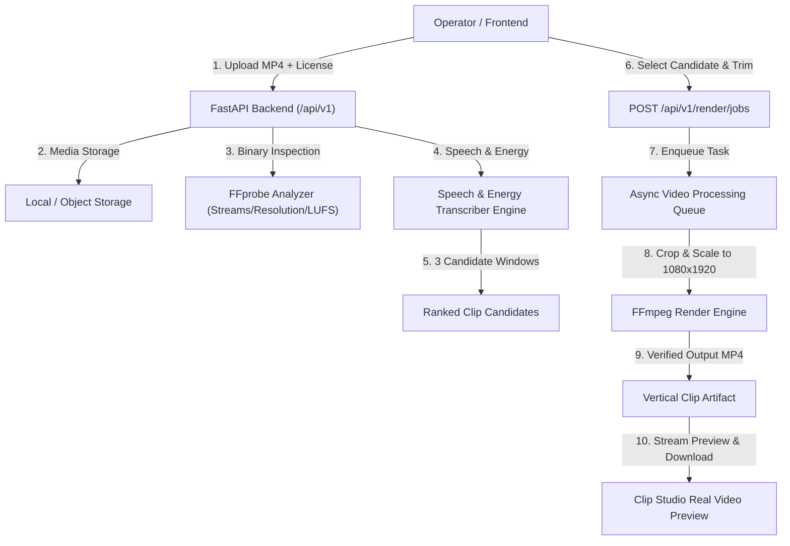

# Argon High — Architectural Audit & Sprint 1 Implementation Plan

## Executive Summary
Argon High is an intelligence-driven AI clipping and campaign analytics platform designed for high-velocity clipping operations with multi-tenant SaaS expansion potential. This document fulfills **Step 1 (Audit)** and sets the blueprint for **Sprint 1: Real Application Foundation**.

---

## 1. Architectural Audit

### 1.1 Frontend Stack & Tooling
* **Framework**: React 19.0.0 with TypeScript 5.7.0.
* **Build Tooling**: Vite 8.3.5 with `@vitejs/plugin-react` and `@tailwindcss/vite` 4.0.0.
* **Styling**: Tailwind CSS v4 using modern theme variables, custom Vibe design token palette (`--color-vibe-primary`, `--color-vibe-bg-*`, etc.), custom monospace timecode fonts, and responsive grid layouts.
* **Icons**: `lucide-react` 1.68.0.
* **Component System**: Custom Vibe components (`VibeButton`, `VibeAttentionBox`, `VibeBadge`, `OperationalStatusBadge`, `MetricCard`, `ProgressBar`, `SegmentedControl`).
* **Routing**: In-memory tab-based state navigation (`NavSection`: `command-center`, `campaign-radar`, `clip-studio`, `argon-guard`, `review-queue`, `performance-lab`).
* **State Persistence**: Local storage key `argon_high_ops_state_v2_5` holding the operational state tree, seeded by `src/data/mockArgonData.ts`.

### 1.2 View-by-View Functional Analysis

| View / Module | Purpose | Current Functional State | Mock / Simulated Boundaries |
| :--- | :--- | :--- | :--- |
| **Command Center** | Operational overview, live pipeline velocity, active campaign cards, ledger summary | Functional local state calculations & navigation triggers | Real metrics computed from local state; financial reconciliations are deterministic seed data |
| **Campaign Radar** | Campaign briefing, sponsor caps, rule cards, brief parser | Functional brief regex parsing (`parseCampaignBriefLocally`) | Scrapes/external feeds simulated; campaigns stored in local storage |
| **Clip Studio** | Master feed monitor, candidate selection strip, 9:16 interactive crop, safe-zone overlays, trim controls, caption presets | Interactive UI with working trim adjustments and local compliance check recalculations | Video feed was DOM mockup; hook analysis was simulated timer; render job was simulated progress timer without binary MP4 generation |
| **Argon Guard** | Rule compliance validator, category filtering, manual attestation toggle, audit export | Live compliance rule engine evaluating clip bounds against campaign rules | Evaluates metadata rules and operator attestations; FFprobe binary media stream verification was marked "Awaiting integration" |
| **Review Queue** | Two-operator sign-off, decision routing (Approved, Rejected, Changes Requested) | State transitions fully update clip and approval record lists | Rejection/approval logs saved to local storage; publication dispatch simulated |
| **Performance Lab** | CPM ledger, platform distribution, accrual vs settled payout tables | Interactive table filters, dispute toggles, export CSV | View counts and telemetry reconciled locally; platform OAuth webhooks simulated |

### 1.3 Service Adapter Layer (`argonAdapters.ts`)
The codebase cleanly defines explicit adapter boundaries:
1. `campaign-ingestion`: Brief parsing & CPM / payout cap calculation.
2. `media-source-auth`: Source upload registration & license proof metadata.
3. `ai-transcription-intelligence`: Diarized speech & 4-factor hook scoring.
4. `ffmpeg-video-render`: 9:16 vertical MP4 video rendering.
5. `compliance-validation`: Multi-factor rule checks.
6. `publication-payout-telemetry`: Financial ledger reconciliation.

---

## 2. Sprint 1 Implementation Blueprint

### 2.1 Backend Architecture (`backend/`)
- **Runtime**: Python 3.12 + FastAPI + Uvicorn + Pydantic v2.
- **Async Processing**: Background task worker queue with in-memory job state repository, extensible to Redis/Celery.
- **Media Engine**: Native FFmpeg and FFprobe wrapper with stream validation, audio loudness inspection (EBU R128), smart vertical crop framing (9:16 `crop=ih*9/16:ih:(iw-ow)/2:0,scale=1080:1920`), H.264 High Profile encoding, and AAC 48kHz audio.
- **Safety Controls**: File type validation (Magic bytes & container inspection), maximum duration / file size limits, rate limits, workspace isolation.

### 2.2 Persistence (Supabase PostgreSQL Migration)
- Multi-tenant architecture with `workspaces`, `workspace_members`, and workspace-scoped entities:
  - `campaigns` & `campaign_rules`
  - `source_assets`
  - `clips`
  - `processing_jobs`
  - `qa_results`
  - `approvals`
  - `publications`
  - `payouts`
- Row Level Security (RLS) policies checking `auth.uid() = workspace_members.user_id`.
- Supabase storage bucket policies for raw uploads and rendered vertical clips.

### 2.3 Real Vertical Slice Workflow
1. **Upload**: User uploads authorized video via Clip Studio.
2. **Inspect**: FFprobe extracts duration, resolution, codecs, and audio levels.
3. **Transcribe & Detect Candidates**: Speech intelligence extracts 3 high-impact timestamp candidate ranges with hook velocity scores.
4. **Trim & Select**: Operator selects candidate or adjusts start/end trim.
5. **Render 1080x1920**: Asynchronous FFmpeg job scales, crops to 9:16 (1080x1920), normalizes audio, and validates the output file.
6. **Preview & Download**: Frontend loads the rendered MP4 into the video player with real HTML5 `<video>` preview and direct download.
